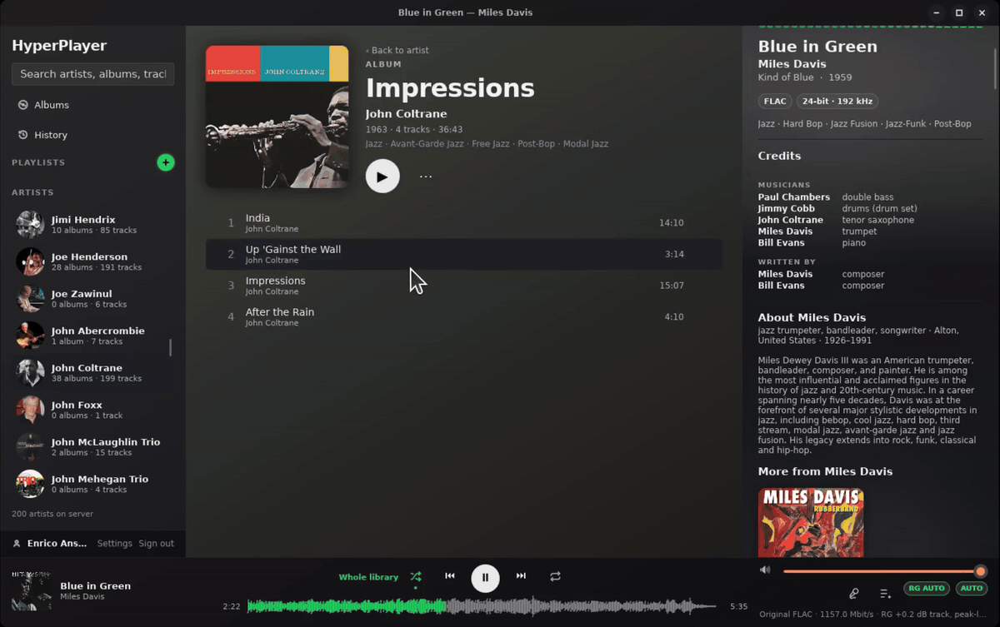

# HyperPlayer

A self-hosted music player: a server that keeps your music library and streams it, and native players
for Linux and Windows that play it, at home or anywhere.



- **Your library, kept current:** music folders on the server's disks or on network shares (SMB), rescanned
  as files change. Tags, artwork and MusicBrainz ids are read from the files; credits and artist profiles
  come from MusicBrainz and Wikipedia.
- **Streaming that fits the connection:** original files when the link allows, otherwise transcoded on the
  fly, switching quality mid-track when needed. Gapless playback and ReplayGain.
- **Browse and play:** artists, albums, search, playlists, and a play queue that follows you from one
  device to the next.
- **While it plays:** synced lyrics, a waveform seek bar, a live spectrum, colours taken from the cover,
  and the desktop's media keys and controls.
- **Listening history** with your most played tracks and artists, and scrobbling to ListenBrainz and
  Last.fm (including "now playing").
- **For the household:** an account for everyone, with their own playlists, history and preferences. HTTPS
  built in, or behind your reverse proxy.

HyperPlayer is in beta (0.1.1).

## Download

| Platform | Download |
| --- | --- |
| Linux (x86-64) | [Server and player](https://github.com/ansa70/hyperplayer/releases/download/v0.1.1/hyperplayer-0.1.1-linux-x64.tar.gz) · [Player only (Flatpak)](https://github.com/ansa70/hyperplayer/releases/download/v0.1.1/hyperplayer-0.1.1-x86_64.flatpak) |
| Windows 10 and 11 (x64) | [Installer](https://github.com/ansa70/hyperplayer/releases/download/v0.1.1/hyperplayer-0.1.1-windows-x64-setup.exe) |
| macOS 11 or newer (player only, not tested yet) | [Apple silicon](https://github.com/ansa70/hyperplayer/releases/download/v0.1.1/hyperplayer-0.1.1-macos-arm64.dmg) · [Intel](https://github.com/ansa70/hyperplayer/releases/download/v0.1.1/hyperplayer-0.1.1-macos-x64.dmg) |

Checksums and earlier versions are on the [releases page](https://github.com/ansa70/hyperplayer/releases).

## Installing

Each release has these downloads:

- `hyperplayer-<version>-linux-x64.tar.gz`: the server and the player for Linux (x86-64).
- `hyperplayer-<version>-x86_64.flatpak`: the player alone, as a Flatpak for any Linux distribution.
- `hyperplayer-<version>-windows-x64-setup.exe`: the player and the server for Windows 10 and 11 (x64).
- `hyperplayer-<version>-macos-arm64.dmg` and `-macos-x64.dmg`: the player for macOS 11 or newer, on Apple
  silicon and Intel Macs.

Install the server once, on the machine that has (or reaches) the music, and the player on every computer
you listen on. Server and player can be on the same machine.

### Linux

```bash
tar xzf hyperplayer-<version>-linux-x64.tar.gz
cd hyperplayer-<version>-linux-x64
sudo ./install.sh
```

The wizard asks what to install on this machine: the server, the player, or both.

- **Server:** choose how it runs, in a **Docker** container (needs Docker with the Compose plugin) or as a
  **systemd service** (it installs ffmpeg with apt if needed). Then it asks for the music folders (in
  Docker also SMB shares, which the container mounts itself), the port, HTTPS (a self-signed certificate,
  your own certificate files, or off behind a reverse proxy) and, optionally, a Last.fm API account. At
  the end it shows the address to connect players to and the certificate's fingerprint.
- **Player:** a `.deb` package (Ubuntu 26.04 or newer) or a Flatpak (any distribution; Flatpak needs to be
  installed). It appears in the applications menu. The Flatpak also installs on its own:
  `flatpak install --user hyperplayer-<version>-x86_64.flatpak`.

To upgrade, run the new version's `install.sh`: it keeps the settings (or lets you change them). To
remove HyperPlayer, run `sudo ./install.sh --uninstall`; it asks before deleting the server's data.

The server's settings are in `/etc/hyperplayer/server.env` (edit, then restart the server), its data in
`/var/lib/hyperplayer`. Its log: `docker logs hyperplayer`, or `journalctl -u hyperplayer-server`.

### Windows

Run `hyperplayer-<version>-windows-x64-setup.exe`. The installer isn't signed yet, so Windows SmartScreen
warns about it: click **More info**, then **Run anyway**. It needs administrator rights.

- Choose the components: the **Player**, a desktop shortcut, and the **Server**.
- With the server, the installer asks for the music folders (network shares like `\\nas\Music` work, with
  the account to connect to them), the port, HTTPS and, optionally, a Last.fm API account. The server runs
  as the "HyperPlayer server" service and starts with Windows; the finish page shows its address and
  certificate fingerprint.
- Other computers reach the server when the PC's network is set to **Private** in Windows (the installer
  opens the firewall for private and domain networks).

To upgrade, run the new installer: it offers to keep the server's settings. To remove HyperPlayer, use
**Settings → Apps → Installed apps**; it asks before deleting the server's data.

The server's settings are in `C:\ProgramData\HyperPlayer\server.env` (edit, then restart the HyperPlayer
service), its data and logs next to them.

### macOS

> [!WARNING]
> The macOS player hasn't been tested yet. Reports of what works and what doesn't are welcome.

Only the player runs on macOS so far: connect it to a server on Linux or Windows. Open the `.dmg` for your
Mac (`arm64` for Apple silicon, `x64` for Intel) and drag **HyperPlayer** to **Applications**.

The app isn't notarized by Apple, so the first time macOS refuses to open it. Open **System Settings →
Privacy & Security**, scroll down to the message about HyperPlayer and click **Open Anyway**.

### First sign-in

1. Open the player and enter the server's address, e.g. `https://music-server:4533`.
2. With a self-signed certificate, the player asks whether to trust the server and shows the
   certificate's fingerprint: check it matches the one the installer showed, then trust it. A certificate
   from a public authority (yours, or your reverse proxy's) needs no question.
3. Sign in as `admin` with the password `hyperplayer`, and choose your own password right away; do it
   before making the server reachable from the internet.
4. Create your own account for everyday listening (the admin account stays for managing the server), and
   accounts for everyone else in **Settings → Server**.

### Behind a reverse proxy

Choose HTTPS **off** in the installer, and point the proxy's rule for your domain at the whole server
(`http://<server>:<port>`, no path prefix). Audio streams stay open for a whole track and seeking uses
`Range` requests: don't set short timeouts or response buffering on the rule. Players then connect to
`https://<your domain>`.

## Privacy

HyperPlayer sends nothing about you or what you listen to anywhere you haven't chosen: the player only
talks to your server. The server looks up the artists, albums and tracks in your library at MusicBrainz,
Wikipedia and a few similar services, for credits, biographies, artwork and lyrics (it can be turned
off), and each user can turn on scrobbling. The details are in the [privacy policy](PRIVACY.md).

## License

HyperPlayer is free software: you can redistribute it and/or modify it under the terms of the
[GNU General Public License](LICENSE), version 3 or (at your option) any later version.

The releases bundle third-party software under its own licenses: Node.js (MIT), FFmpeg (LGPL-2.1 or later)
and libvips through sharp (LGPL-3.0 or later, sharp itself Apache-2.0). The player is built with
[Slint](https://slint.dev), used under the GPL-3.0.

## Development

| Path               | What                                                                                                         |
| ------------------ | ------------------------------------------------------------------------------------------------------------ |
| `packages/schemas` | Zod models + HTTP API contract. **Single source of truth for every type.**                                   |
| `apps/server`      | Node/TypeScript server (Fastify, `node:sqlite`): library scan, catalog, artwork, streaming, ffmpeg transcode |
| `apps/client`      | Native client in Rust + Slint, audio via rodio/symphonia                                                     |
| `api/`             | Generated `schema.json` (→ Rust types via typify) and `openapi.json`. Do not edit.                           |

## How types flow

```
packages/schemas (Zod) ──► server: validates params/query/responses at runtime, types handlers at compile time
         │
         └─ vp run @hyperplayer/schemas#generate ──► api/schema.json ──► apps/client/build.rs (typify) ──► Rust structs
```

Change a schema, and the server stops type-checking and the client stops compiling until both match.

## Requirements

- [Vite+](https://viteplus.dev) (`vp`), Node ≥ 22.18, Rust (rustup)
- Linux: `libfontconfig-dev libasound2-dev ffmpeg`

## Commands

```bash
vp install
vp run dev             # generate types, then run server + client together
vp run server          # server only (HP_LIBRARY=~/Music by default)
vp run client          # client only (HP_SERVER=http://127.0.0.1:4533 by default)
vp run ready           # fmt + lint + typecheck + all tests + clippy + release build
```

Server environment: `HP_LIBRARY`, `HP_DATA_DIR` (default `apps/server/.data`), `HP_HOST`, `HP_PORT` (4533),
`HP_FFMPEG`, `HP_VALIDATE_RESPONSES`. The OpenAPI document is served at `/openapi.json`.

## Building releases

`packaging/linux/build-release.sh` builds `release/hyperplayer-<version>-linux-x64.tar.gz`: the server
bundled with `vp pack` and its own Node.js, the Docker build files, the systemd unit, the player's `.deb`
(built against this machine's libraries, so it installs on the same distribution release or newer), the
Flatpak (when Flathub's `org.flatpak.Builder` is installed; `packaging/flatpak/build.sh` builds it alone),
and `install.sh`.

- The server runs either in Docker (the image is built on the host from the bundle) or as a systemd
  service. Either way it runs as the `hyperplayer` user, reads its settings from `/etc/hyperplayer/server.env`
  and keeps its data in `/var/lib/hyperplayer`, so switching between the two keeps the library and accounts.
- In Docker, the container can mount SMB shares itself (read-only); their credentials stay in
  `/etc/hyperplayer` and `/opt/hyperplayer/compose.yaml`, readable by root only. Docker in an unprivileged
  Proxmox LXC can't mount SMB: mount the share on the Proxmox host and pass the folder in instead.

`packaging/windows/build.sh` cross-compiles the Windows release from Linux (needs `clang lld llvm nsis`,
the `x86_64-pc-windows-msvc` Rust target and `cargo install cargo-xwin`; the C runtime is linked in, so
nothing else is needed on the PC) and builds `release/hyperplayer-<version>-windows-x64-setup.exe` with
NSIS (`build.sh stage` builds the programs and the uninstaller, `build.sh installer` packs them; releases
sign in between). The server is bundled with Windows builds of Node.js, sharp and ffmpeg, and run as a service by
`apps/winservice` (`hyperplayer-service.exe`), which also connects the network shares with the saved
credentials; settings and data are in `%ProgramData%\HyperPlayer`, readable only by administrators and the
service.

GitHub Actions checks every push (`.github/workflows/ci.yml`) and builds the releases
(`.github/workflows/release.yml`): pushing a tag `v<version>` builds both bundles and creates a draft release.
It can sign the Windows files through SignPath (see `packaging/windows/signpath`) once the repository
variable `SIGNPATH_ORGANIZATION_ID` and secret `SIGNPATH_API_TOKEN` are set; the releases aren't signed yet.

Versions follow [Semantic Versioning](https://semver.org): bug fixes raise the third number (0.1.1), new
features the second (0.2.0), and 0.x means the project is still in beta. The player's `Cargo.toml` and the
server's `SERVER_VERSION` must match (the release scripts check). Versions up to 0.1.0-beta.3 had a suffix;
the `.deb` spells one with `~` (`0.1.0~beta.1`) so it sorts before `0.1.0`.

## HTTPS

`HP_TLS` (`auto` by default) serves HTTPS whenever the server listens beyond this machine, and plain HTTP
when it only listens on `127.0.0.1` (development). `on` and `off` force it either way; use `off` behind a
reverse proxy that does HTTPS.

- With `HP_TLS_CERT` and `HP_TLS_KEY` (PEM files, e.g. from Let's Encrypt), the server uses them and picks
  up renewed files within an hour, without a restart.
- Without them it makes a self-signed certificate in `HP_DATA_DIR/tls`, valid for 10 years and naming the
  host, its addresses and any extra `HP_TLS_NAMES` (comma-separated). It logs the certificate's SHA-256
  fingerprint at startup.

The client trusts certificates from public authorities as usual. The first time it meets a self-signed one,
it shows the fingerprint and asks whether to trust it (compare it with the server's log); from then on it
accepts only that certificate for that server. Trusted fingerprints are kept in
`~/.config/hyperplayer/trusted-servers.json`. A server address typed without `https://` or `http://` uses
HTTPS, except `localhost` and `127.0.0.1`.

## Library folders

`HP_LIBRARY` lists one or more music folders, separated like `PATH`
(`HP_LIBRARY=/mnt/storage/Music:/home/me/Music`). They make one library, kept current without restarts:

- **Periodic rescans** (`HP_RESCAN_MINUTES`, default 5; 0 disables) work on every filesystem, including
  network shares (SMB/CIFS, NFS), which don't report changes made on the server side. They're cheap:
  unchanged files are only `stat`ed (a 14,000-track share rescans in under a second).
- **Watching** (`HP_WATCH`, on by default) picks local changes up within seconds where the filesystem
  reports them. Folders that can't be watched (missing, unsupported) fall back to the rescans, and
  watching starts once they appear.
- A folder that is **missing or reads as empty** (an unmounted share or drive) keeps its tracks, so queues,
  playlists and history survive until it's back. A folder removed from `HP_LIBRARY` takes its tracks with it.
- Files modified in the last few seconds are left for the next scan, so half-copied files aren't read.

## Enrichment

After each scan the server fetches, in the background (MusicBrainz allows 1 request/s; the playing track
jumps the queue):

- **Per-track credits** from one MusicBrainz release lookup per album: performers and instruments per
  recording, writers per work, producers/engineers per release. Files tagged by Picard/Lidarr are matched by
  release and recording id; untagged albums are searched. If the library's edition has no credits (common for
  reissues), credits are taken from another edition of the same release group.
- **File tags** (`PERFORMER`, `TMCL`, composer, producer, …) are used until/unless MusicBrainz has credits.
- **Artist profiles**: type, origin, years, band members and links (MusicBrainz); biography (Wikipedia, via
  Wikidata); photo (Wikimedia Commons, or fanart.tv with a key, which also provides banners).

Settings: `HP_ENRICH` (default `true`), `HP_CONTACT` (sent in the User-Agent as MusicBrainz requests),
`HP_WIKI_LANG` (biography language, falls back to English), `HP_FANART_KEY`.

## Scrobbling

Each user can send their listens to ListenBrainz (with their user token) and Last.fm (allowed in the
browser from Settings). Listens are queued on the server and retried until the service has them.

Last.fm needs an API account for the server: create one at https://www.last.fm/api/account/create and set
`HP_LASTFM_API_KEY` and `HP_LASTFM_SECRET`. Without them, Last.fm shows as unavailable.

## Streaming

The client plays while it downloads (bounded read-ahead; seeks in originals use HTTP Range requests) and
decodes on its own thread, so a slow network never blocks the audio device.

In **Auto** mode it measures throughput while prebuffering and picks the best stream the link sustains:
the original file, or an ffmpeg transcode to Ogg Vorbis at 320/192/128/96/64 kbit/s (lossy sources are never
re-encoded upwards). During playback it steps down, resuming at the same position, when the download lags
the bitrate or audio underruns. The mode chip in the player cycles Auto → Original → Data saver (≤128 kbit/s).

- Client: `HP_QUALITY=original|data-saver` sets the initial mode.
- Server: `HP_DEBUG_THROTTLE_KBPS` caps every stream, to exercise adaptation on a fast network.
- `cargo run --example stream_probe -- "<title>" <seconds> [original]` (in `apps/client`) plays a track
  headlessly and logs quality decisions, throughput, memory and underruns.

## Search, playlists and the play queue

- **Search** uses an SQLite FTS5 index: every word must match (as a prefix) in a title, artist or album
  name, or a credited musician ("coltrane" finds every track he plays on). Case and accents are ignored;
  an entity's own name ranks above what it belongs to, which ranks above credits.
- **Playlists** live on the server. Entries store a snapshot (title, artist, album, MusicBrainz recording)
  next to the track id, so moving files or rescanning relinks them instead of dropping them.
- **The play queue** lives on the server too, one per device: the client generates a device id
  (`~/.config/hyperplayer/settings.json`, which also keeps volume and quality mode) and sends every
  navigation (next, previous, jump, shuffle, repeat) to `/api/devices/{device}/queue`. The queue and the
  playback position survive restarts of either side.
- **Safety:** a scan never removes tracks when the library folder is missing or reads as empty
  (e.g. an unmounted network share).

## Accounts and security

- Every endpoint declares its access level in the contract (`public`, `session`, `user` or `admin`, defaulting to `user`);
  the router enforces it, a schema test pins the public set to sign-in only (and the `session` set, usable before
  replacing a default password, to me/change-password/sign-out), and a server test calls every other endpoint
  anonymously to check it answers 401.
- **First start:** the server creates `admin` with the default password `hyperplayer` (override with
  `HP_DEFAULT_ADMIN_PASSWORD`, e.g. from an installer). Signing in with it works, but that session can only read
  `/api/me`, change the password or sign out; everything else answers `password_change_required` until a new
  password is set, after which the default stops working. Playlists without an owner are adopted by the first admin.
- **Devices:** signing in creates a device with a random 256-bit token (`Authorization: Bearer`). The server
  stores only its SHA-256; passwords are Argon2id. Devices can be listed and revoked; changing the password signs
  out all other devices. Failed sign-ins are rate-limited per IP and per username.
- **Client:** the token is kept in the OS keyring (Secret Service on Linux), falling back to a `0600` file.
- **Browsers (future web client):** sign-in can set an `HttpOnly; SameSite=Strict; Secure` cookie instead;
  cookie-authenticated writes must carry a same-origin `Origin` (CSRF protection). Cross-origin access is off
  unless listed in `HP_CORS_ORIGINS`.
- **TLS:** tokens are only as safe as the connection. Keep the server on a trusted LAN, or put it behind an HTTPS
  reverse proxy (set `HP_TRUST_PROXY=true` there, so rate limits see real client IPs). `HP_SECURE_COOKIES=false`
  is for plain-HTTP development only.

## Desktop integration

The client registers as an MPRIS player (`org.mpris.MediaPlayer2.hyperplayer`) via souvlaki's pure-Rust D-Bus
backend: media keys, headset buttons, KDE Connect/GSConnect and the GNOME/KDE media widgets can play, pause, skip
and seek, and show title, artist, album, duration and cover. Covers are cached as JPEG under
`~/.cache/hyperplayer/covers` because desktop shells can't fetch the authenticated artwork URLs. The same crate
provides the macOS and Windows media controls.

## ReplayGain

The scanner reads ReplayGain track/album gain and peak tags and serves them with every track. The client applies
the gain in its audio pipeline (instantly, not after the buffer), capped by the tagged peak so boosts never clip.
Modes, a per-user preference cycled by the **RG** chip: _Auto_ (album gain while an album plays in order, track
gain when shuffling or mixing), _Track_, _Album_, _Off_; plus a pre-amp (`replayGainPreamp`, ±15 dB). Untagged
files play unchanged.
