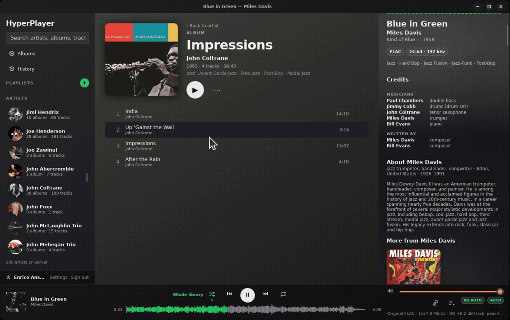

# HyperPlayer

A music player for your own music: native players for Linux, Windows and macOS that play the music on
your computer, and a self-hosted server that keeps your library and streams it to them, at home or
anywhere, and to any browser, phones included.



- **Just the player, or a server too:** the player alone plays the music on your computer, with nothing
  else to install. Add a server to share one library with every device.
- **Your library, kept current:** music folders on your disks or on network shares (SMB), rescanned
  as files change. Tags, artwork and MusicBrainz ids are read from the files; credits and artist profiles
  come from MusicBrainz and Wikipedia.
- **Streaming that fits the connection:** original files when the link allows, otherwise transcoded on the
  fly, switching quality mid-track when needed. Gapless playback and ReplayGain.
- **Browse and play:** artists, albums, search, playlists, and a play queue that follows you from one
  device to the next.
- **While it plays:** synced lyrics, a waveform seek bar, a live spectrum, colours taken from the cover,
  and the desktop's media keys and controls.
- **Internet radio:** tens of thousands of free stations from the [Radio Browser](https://www.radio-browser.info)
  directory, by country, language and genre, with favourites and the song playing. Stations not listed can
  be added by their address. The server relays them, so any format plays, in both players.
- **Listening history** with your most played tracks and artists, and scrobbling to ListenBrainz and
  Last.fm (including "now playing").
- **In the browser too:** the server serves a web player at its address, laid out like the desktop
  player on computers and made for phones on phones, installable as an app (Android, iPhone, Chrome, Edge).
- **Your own uploads:** everyone can upload music of their own, which only they see and play.
- **For the household:** an account for everyone, with their own playlists, history and preferences. HTTPS
  built in, or behind your reverse proxy.

HyperPlayer is in beta (0.7.0).

## Download

| Platform                                        | Download                                                                                                                                                                                                                                          |
| ----------------------------------------------- | ------------------------------------------------------------------------------------------------------------------------------------------------------------------------------------------------------------------------------------------------- |
| Linux (x86-64)                                  | [Server and player](https://github.com/ansa70/hyperplayer/releases/download/v0.7.0/hyperplayer-0.7.0-linux-x64.tar.gz) · [Player only (Flatpak)](https://github.com/ansa70/hyperplayer/releases/download/v0.7.0/hyperplayer-0.7.0-x86_64.flatpak) |
| Windows 10 and 11 (x64)                         | [Player (Microsoft Store)](https://apps.microsoft.com/detail/9MZB5KGB92RD) · [Server](#the-server-on-windows)                                                                                                                                     |
| macOS 11 or newer (player only, not tested yet) | [Apple silicon](https://github.com/ansa70/hyperplayer/releases/download/v0.7.0/hyperplayer-0.7.0-macos-arm64.dmg) · [Intel](https://github.com/ansa70/hyperplayer/releases/download/v0.7.0/hyperplayer-0.7.0-macos-x64.dmg)                       |

Checksums and earlier versions are on the [releases page](https://github.com/ansa70/hyperplayer/releases).

## Installing

Each release has these downloads:

- `hyperplayer-<version>-linux-x64.tar.gz`: the server and the player for Linux (x86-64).
- `hyperplayer-<version>-x86_64.flatpak`: the player alone, as a Flatpak for any Linux distribution.
- `compose.yaml`: the server in Docker, from the image `ghcr.io/ansa70/hyperplayer` (see below, for
  Windows; on Linux the installer sets up Docker for you).
- `install-server.ps1` and `hyperplayer-<version>-windows-x64-server.zip`: the server as a Windows service,
  installed by the script (see below).
- `hyperplayer-<version>-macos-arm64.dmg` and `-macos-x64.dmg`: the player for macOS 11 or newer, on Apple
  silicon and Intel Macs.

On Windows the player comes from the [Microsoft Store](https://apps.microsoft.com/detail/9MZB5KGB92RD).

There are two ways to use HyperPlayer:

- **A standalone player** keeps its own library of your music folders, on the computer's disks or on a
  network share it can open. At its first start, choose **Standalone player** and then your music folder
  (more can be added in Settings). It keeps the library itself, while it's open; nothing else to install
  or set up.
- **A server and players:** install the server once, on the machine that has (or reaches) the music, and
  the player on every computer you listen on. One library for every device, with a play queue that
  follows you from one to the next and an account for everyone in the household. At the first start,
  choose **Connect to a HyperPlayer server**.

A standalone player can also bring in the music of HyperPlayer servers (**Settings → Library → Servers**):
it joins the player's library, merged with the music on the computer, and plays from the server.

**Switch library**, at the bottom of the player's sidebar, goes back to that choice.

### Linux

```bash
tar xzf hyperplayer-<version>-linux-x64.tar.gz
cd hyperplayer-<version>-linux-x64
sudo ./install.sh
```

The wizard asks what to install on this machine: the server, the player, or both.

- **Server:** choose how it runs, in a **Docker** container (needs Docker with the Compose plugin) or as a
  **systemd service** (it installs ffmpeg with apt if needed). Then it asks for the music folders (in
  Docker also SMB shares, which the container mounts itself), the port, HTTPS (a self-signed certificate,
  your own certificate files, or off behind a reverse proxy) and, optionally, a Last.fm API account. At
  the end it shows the address to connect players to and the certificate's fingerprint. In Docker it also
  enables `hyperplayer-docker.service`: if the container can't start at boot because a share isn't
  answering yet (e.g. the NAS is still booting), it retries for up to an hour (`journalctl -u
  hyperplayer-docker`).
- **Player:** a `.deb` package (Ubuntu 26.04 or newer) or a Flatpak (any distribution; Flatpak needs to be
  installed). It appears in the applications menu. Both work as a standalone player too;
  the `.deb` recommends ffmpeg, for waveforms and formats the player can't decode itself (the Flatpak has
  its own). The Flatpak reads music in your home folder and under `/mnt`, `/media` and `/run/media`. The Flatpak also installs on its own:
  `flatpak install --user hyperplayer-<version>-x86_64.flatpak`.

To upgrade, run the new version's `install.sh`: it keeps the settings (or lets you change them). To
remove HyperPlayer, run `sudo ./install.sh --uninstall`; it asks before deleting the server's data.

The server's settings are in `/etc/hyperplayer/server.env` (edit, then restart the server), its data in
`/var/lib/hyperplayer`. Its log: `docker logs hyperplayer`, or `journalctl -u hyperplayer-server`.

### Windows

#### The player

Get the player from the [Microsoft Store](https://apps.microsoft.com/detail/9MZB5KGB92RD) (Windows 10 and
11). It installs without administrator rights or SmartScreen warnings, and the Store keeps it up to date.
It plays the music on this PC by itself: you only need a server below to share your music with other
devices.

If you listen on this PC only, the player is all you need: choose **Standalone player** at its first
start. Its library runs inside the player, so there's no service for an antivirus to stop (Bitdefender,
for one, has stopped the server's Windows service). A server, in Docker or as a service, is for one
library shared by several devices or the household; a standalone player can still bring a server's music
in later.

#### The server on Windows

The server runs either in Docker (recommended) or as a Windows service.

**In Docker**, nothing is installed in Windows itself (no service, nothing for an antivirus to stop), and
updating is one command:

1. Install [Docker Desktop](https://www.docker.com/products/docker-desktop/). In its settings, turn on
   **Start Docker Desktop when you sign in to your computer**: the server runs while Docker Desktop does,
   so after a restart it starts once you sign in.
2. Make a folder for it, e.g. `C:\HyperPlayer`, and save
   [compose.yaml](https://github.com/ansa70/hyperplayer/releases/download/v0.7.0/compose.yaml) in it.
3. Open `compose.yaml` in Notepad and change `C:\Users\Me\Music` to your music folder. The comments in it
   show how to add more folders, a share on a NAS, Last.fm and a reverse proxy.
4. Open a terminal in that folder (right-click it, **Open in Terminal**) and run:

   ```powershell
   docker compose up -d
   ```

The server listens on port 4533 with a self-signed certificate. Its log, with the certificate's
fingerprint for the first sign-in: `docker logs hyperplayer`. Other computers reach it when the PC's
network is set to **Private** in Windows. After changing `compose.yaml`, run `docker compose up -d` again.

To update, in the same folder: `docker compose pull`, then `docker compose up -d`. To remove it:
`docker compose down` (add `--volumes` to delete the server's data too).

**As a Windows service**, without Docker, the server runs as the "HyperPlayer server" service, which
starts with Windows. Some antivirus programs stop it; if yours does, use Docker or a standalone player
instead. A PowerShell script installs it; open an administrator PowerShell (right-click **Start**,
**Terminal (Admin)**) and run:

```powershell
irm https://github.com/ansa70/hyperplayer/releases/download/v0.7.0/install-server.ps1 | iex
```

It downloads the server, checks it against the release's checksums and asks for the music folders
(network shares like `\\nas\Music` work, with the account to connect to them), the port, HTTPS and,
optionally, a Last.fm API account. At the end it shows the server's address and certificate fingerprint.
Running it again updates the server and offers to keep its settings. To read the script before running
it, download `install-server.ps1` and run `powershell -ExecutionPolicy Bypass -File install-server.ps1`.
Without questions, pass the settings (`-Library 'D:\Music;\\nas\Music'`, `-Port`, `-Tls self|files|off`,
`-KeepSettings` for an update; the list is at the top of the script):

```powershell
& ([scriptblock]::Create((irm https://github.com/ansa70/hyperplayer/releases/download/v0.7.0/install-server.ps1))) -KeepSettings
```

Other computers reach the server when the PC's network is set to **Private** in Windows (the firewall is
opened for private and domain networks). The server's settings are in
`C:\ProgramData\HyperPlayer\server.env` (edit, then restart the HyperPlayer service), its data and logs
next to them. To remove it, use **Settings → Apps → Installed apps** (_HyperPlayer server_), or run the
script with `-Uninstall`.

Up to 0.6.0 there was also a Windows installer (`setup.exe`) with the player and the server; it isn't
made any more. To move off it, remove _HyperPlayer_ in **Settings → Apps → Installed apps** (answer **No**
when it asks whether to delete the server's data), then get the player from the Store and, if you had the
server, run the script above: it finds the kept settings and library.

### macOS

> [!WARNING]
> The macOS player hasn't been tested yet. Reports of what works and what doesn't are welcome.

Only the player runs on macOS so far: it plays the music on this Mac, or connects to a server on Linux or
Windows. Open the `.dmg` for your Mac (`arm64` for Apple silicon, `x64` for Intel) and drag
**HyperPlayer** to **Applications**. For waveforms and formats the player can't decode itself, install
ffmpeg with [Homebrew](https://brew.sh) (`brew install ffmpeg`).

The app isn't notarized by Apple, so the first time macOS refuses to open it. Open **System Settings →
Privacy & Security**, scroll down to the message about HyperPlayer and click **Open Anyway**.

### First sign-in

With a server (a standalone player has nothing to sign in to):

1. Open the player, choose **Connect to a HyperPlayer server** and enter the server's address, e.g. `https://music-server:4533`.
2. With a self-signed certificate, the player asks whether to trust the server and shows the
   certificate's fingerprint: check it matches the one the installer showed, then trust it. A certificate
   from a public authority (yours, or your reverse proxy's) needs no question.
3. Sign in as `admin` with the password `hyperplayer`, and choose your own password right away; do it
   before making the server reachable from the internet.
4. Create your own account for everyday listening (the admin account stays for managing the server), and
   accounts for everyone else in **Settings → Server**.

The web player needs nothing installed: open the server's address in a browser (e.g.
`https://music.example.com`) and sign in with the same account.

### Behind a reverse proxy

Choose HTTPS **off** in the installer, and point the proxy's rule for your domain at the whole server
(`http://<server>:<port>`, no path prefix). Audio streams stay open for a whole track and seeking uses
`Range` requests: don't set short timeouts or response buffering on the rule. Players then connect to
`https://<your domain>`.

## Privacy

HyperPlayer sends nothing about you or what you listen to anywhere you haven't chosen: the player only
talks to your server. The server looks up the artists, albums and tracks in your library at MusicBrainz,
Wikipedia and a few similar services, for credits, biographies, artwork and lyrics (it can be turned
off), and each user can turn on scrobbling. The details are in the [privacy policy](PRIVACY.md).

## License

HyperPlayer is free software: you can redistribute it and/or modify it under the terms of the
[GNU General Public License](LICENSE), version 3 or (at your option) any later version.

The releases bundle third-party software under its own licenses: Node.js (MIT), FFmpeg (LGPL-2.1 or later)
and libvips through sharp (LGPL-3.0 or later, sharp itself Apache-2.0). The player is built with
[Slint](https://slint.dev), used under the GPL-3.0.

## Development

| Path               | What                                                                                                         |
| ------------------ | ------------------------------------------------------------------------------------------------------------ |
| `packages/schemas` | Zod models + HTTP API contract. **Single source of truth for every type.**                                   |
| `apps/server`      | Node/TypeScript server (Fastify, `node:sqlite`): library scan, catalog, artwork, streaming, ffmpeg transcode |
| `apps/client`      | Native client in Rust + Slint, audio via rodio/symphonia                                                     |
| `api/`             | Generated `schema.json` (→ Rust types via typify) and `openapi.json`. Do not edit.                           |

## How types flow

```
packages/schemas (Zod) ──► server: validates params/query/responses at runtime, types handlers at compile time
         │
         └─ vp run @hyperplayer/schemas#generate ──► api/schema.json ──► apps/client/build.rs (typify) ──► Rust structs
```

Change a schema, and the server stops type-checking and the client stops compiling until both match.

## Requirements

- [Vite+](https://viteplus.dev) (`vp`), Node ≥ 22.18, Rust (rustup)
- Linux: `libfontconfig-dev libasound2-dev ffmpeg`

## Commands

```bash
vp install
vp run dev             # generate types, then run server + client together
vp run server          # server only (HP_LIBRARY=~/Music by default)
vp run client          # client only (HP_SERVER=http://127.0.0.1:4533 by default)
vp run web             # web player dev server (proxies /api to http://127.0.0.1:4533; HP_DEV_SERVER overrides)
vp run ready           # fmt + lint + typecheck + all tests + clippy + release build
```

Server environment: `HP_LIBRARY`, `HP_DATA_DIR` (default `apps/server/.data`), `HP_HOST`, `HP_PORT` (4533),
`HP_FFMPEG`, `HP_VALIDATE_RESPONSES`, `HP_WEB_DIR` and the `HP_UPLOAD_*` settings below. The OpenAPI document
is served at `/openapi.json`.

## Building releases

`packaging/linux/build-release.sh` builds `release/hyperplayer-<version>-linux-x64.tar.gz`: the server
bundled with `vp pack` and its own Node.js, the Docker build files, the systemd unit, the player's `.deb`
(built against this machine's libraries, so it installs on the same distribution release or newer), the
Flatpak (when Flathub's `org.flatpak.Builder` is installed; `packaging/flatpak/build.sh` builds it alone),
and `install.sh`.

- The server runs either in Docker (the image is built on the host from the bundle) or as a systemd
  service. Either way it runs as the `hyperplayer` user, reads its settings from `/etc/hyperplayer/server.env`
  and keeps its data in `/var/lib/hyperplayer`, so switching between the two keeps the library and accounts.
- The release workflow also builds the image from the bundle and pushes it to
  `ghcr.io/ansa70/hyperplayer` (the version and `latest`); `packaging/docker/compose.yaml`, which uses it,
  goes in the release for Docker Desktop on Windows.
- In Docker, the container can mount SMB shares itself (read-only); their credentials stay in
  `/etc/hyperplayer` and `/opt/hyperplayer/compose.yaml`, readable by root only. Docker in an unprivileged
  Proxmox LXC can't mount SMB: mount the share on the Proxmox host and pass the folder in instead.

`packaging/windows/build.sh` cross-compiles the Windows release from Linux (needs `clang lld llvm`, the
`x86_64-pc-windows-msvc` Rust target and `cargo install cargo-xwin`; the C runtime is linked in, so nothing
else is needed on the PC): the player and the server (`build.sh stage`), then the server's zip for
`packaging/windows/install-server.ps1` (`build.sh package`; releases sign in between). The player's
Microsoft Store package is made from that `hyperplayer.exe` by `packaging/windows/build-msix.ps1`, on
Windows.
The server is bundled with Windows builds of Node.js, sharp and ffmpeg, and run as a service by
`apps/winservice` (`hyperplayer-service.exe`), which also connects the network shares with the saved
credentials; settings and data are in `%ProgramData%\HyperPlayer`, readable only by administrators and the
service.

GitHub Actions checks every push (`.github/workflows/ci.yml`) and builds the releases
(`.github/workflows/release.yml`): pushing a tag `v<version>` builds both bundles and creates a draft release.
It can sign the Windows files through SignPath (see `packaging/windows/signpath`) once the repository
variable `SIGNPATH_ORGANIZATION_ID` and secret `SIGNPATH_API_TOKEN` are set; the releases aren't signed yet.

Versions follow [Semantic Versioning](https://semver.org): bug fixes raise the third number (0.1.1), new
features the second (0.2.0), and 0.x means the project is still in beta. The player's `Cargo.toml` and the
server's `SERVER_VERSION` must match (the release scripts check). Versions up to 0.1.0-beta.3 had a suffix;
the `.deb` spells one with `~` (`0.1.0~beta.1`) so it sorts before `0.1.0`.

## HTTPS

`HP_TLS` (`auto` by default) serves HTTPS whenever the server listens beyond this machine, and plain HTTP
when it only listens on `127.0.0.1` (development). `on` and `off` force it either way; use `off` behind a
reverse proxy that does HTTPS.

- With `HP_TLS_CERT` and `HP_TLS_KEY` (PEM files, e.g. from Let's Encrypt), the server uses them and picks
  up renewed files within an hour, without a restart.
- Without them it makes a self-signed certificate in `HP_DATA_DIR/tls`, valid for 10 years and naming the
  host, its addresses and any extra `HP_TLS_NAMES` (comma-separated). It logs the certificate's SHA-256
  fingerprint at startup.

The client trusts certificates from public authorities as usual. The first time it meets a self-signed one,
it shows the fingerprint and asks whether to trust it (compare it with the server's log); from then on it
accepts only that certificate for that server. Trusted fingerprints are kept in
`~/.config/hyperplayer/trusted-servers.json`. A server address typed without `https://` or `http://` uses
HTTPS, except `localhost` and `127.0.0.1`.

## Library folders

`HP_LIBRARY` lists one or more music folders, separated like `PATH`
(`HP_LIBRARY=/mnt/storage/Music:/home/me/Music`). They make one library, kept current without restarts:

- **Periodic rescans** (`HP_RESCAN_MINUTES`, default 5; 0 disables) work on every filesystem, including
  network shares (SMB/CIFS, NFS), which don't report changes made on the server side. They're cheap:
  unchanged files are only `stat`ed (a 14,000-track share rescans in under a second).
- **Watching** (`HP_WATCH`, on by default) picks local changes up within seconds where the filesystem
  reports them. Folders that can't be watched (missing, unsupported) fall back to the rescans, and
  watching starts once they appear.
- A folder that is **missing or reads as empty** (an unmounted share or drive) keeps its tracks, so queues,
  playlists and history survive until it's back. A folder removed from `HP_LIBRARY` takes its tracks with it.
- Files modified in the last few seconds are left for the next scan, so half-copied files aren't read.

A standalone player's own library works the same way, with the folder chosen at its first start and the
others added in **Settings → Library**. The player runs the server's code itself for it, as a private _library engine_:
it listens only on `127.0.0.1`, starts and stops with the player, and keeps its data in the user's data
folder (`~/.local/share/hyperplayer/library`, `%LOCALAPPDATA%\HyperPlayer\library`, or
`~/Library/Application Support/HyperPlayer/library`). Its log is `engine.log`, next to the player's.

### Servers in a standalone library

A standalone player can add HyperPlayer servers to its library in **Settings → Library → Servers**,
signing in with an account on each (as a device of its own, listed on the server as
"HyperPlayer on … (library)"). The engine copies each server's catalog into its own library: the same
artist or album on the server and on the computer becomes one. When it rescans its folders, it also
fetches what changed on the servers since the last time (`GET /api/sync`), so this stays cheap however
big the server's library is. The tracks play from the server, which also provides their covers and
waveforms (fetched once, then kept) and lyrics. A server that can't be reached keeps
its tracks in the library; they just don't play until it's back.

A track that is both on the computer and on a server (the server reads the same share, say), or on two
servers, or in two folders, is shown once: same album, disc and track number, same title (or MusicBrainz
recording) and nearly the same length. The computer's own copy is preferred, then the better file; if
its file can't be read (a share that isn't mounted), the server's copy plays instead, and if it's deleted,
the server's copy takes its place in queues, playlists and history.

Playlists, the play queue and listening history (and scrobbling) stay in the player's own library.
Adding a server copies the playlists of its account into the library (smart playlists as their rules),
pointing at the copy of each track the library shows; **Copy playlists** brings those copies up to date
with the server's, and removing the server keeps them. A
self-signed certificate is trusted the same way as when connecting to a server, and from then on only
that certificate is accepted. Removing a server takes its music out of the library and signs the
library out of the server. The servers need HyperPlayer 0.3.0 or later.

## Enrichment

After each scan the server fetches, in the background (MusicBrainz allows 1 request/s; the playing track
jumps the queue):

- **Per-track credits** from one MusicBrainz release lookup per album: performers and instruments per
  recording, writers per work, producers/engineers per release. Files tagged by Picard/Lidarr are matched by
  release and recording id; untagged albums are searched. If the library's edition has no credits (common for
  reissues), credits are taken from another edition of the same release group.
- **File tags** (`PERFORMER`, `TMCL`, composer, producer, …) are used until/unless MusicBrainz has credits.
- **Artist profiles**: type, origin, years, band members and links (MusicBrainz); biography (Wikipedia, via
  Wikidata); photo (Wikimedia Commons, or fanart.tv with a key, which also provides banners).

Settings: `HP_ENRICH` (default `true`), `HP_CONTACT` (sent in the User-Agent as MusicBrainz requests),
`HP_WIKI_LANG` (biography language, e.g. `it`, falling back to English; after a change, biographies already
fetched are fetched again in the background), `HP_FANART_KEY`.

## Scrobbling

Each user can send their listens to ListenBrainz (with their user token) and Last.fm (allowed in the
browser from Settings). Listens are queued on the server and retried until the service has them.

Last.fm needs an API account for the server: create one at https://www.last.fm/api/account/create and set
`HP_LASTFM_API_KEY` and `HP_LASTFM_SECRET`. Without them, Last.fm shows as unavailable.

## Streaming

The client plays while it downloads (bounded read-ahead; seeks in originals use HTTP Range requests) and
decodes on its own thread, so a slow network never blocks the audio device.

In **Auto** mode it measures throughput while prebuffering and picks the best stream the link sustains:
the original file, or an ffmpeg transcode to Ogg Vorbis at 320/192/128/96/64 kbit/s (lossy sources are never
re-encoded upwards). During playback it steps down, resuming at the same position, when the download lags
the bitrate or audio underruns. The mode chip in the player cycles Auto → Original → Data saver (≤128 kbit/s).

- Client: `HP_QUALITY=original|data-saver` sets the initial mode.
- Server: `HP_DEBUG_THROTTLE_KBPS` caps every stream, to exercise adaptation on a fast network.
- `cargo run --example stream_probe -- "<title>" <seconds> [original]` (in `apps/client`) plays a track
  headlessly and logs quality decisions, throughput, memory and underruns.

## Search, playlists and the play queue

- **Search** uses an SQLite FTS5 index: every word must match (as a prefix) in a title, artist or album
  name, or a credited musician ("coltrane" finds every track he plays on). Case and accents are ignored;
  an entity's own name ranks above what it belongs to, which ranks above credits.
- **Playlists** live on the server. Entries store a snapshot (title, artist, album, MusicBrainz recording)
  next to the track id, so moving files or rescanning relinks them instead of dropping them.
- **The play queue** lives on the server too, one per device: the client generates a device id
  (`~/.config/hyperplayer/settings.json`, which also keeps volume and quality mode) and sends every
  navigation (next, previous, jump, shuffle, repeat) to `/api/devices/{device}/queue`. The queue and the
  playback position survive restarts of either side.
- **Safety:** a scan never removes tracks when the library folder is missing or reads as empty
  (e.g. an unmounted network share).

## Accounts and security

- Every endpoint declares its access level in the contract (`public`, `session`, `user` or `admin`, defaulting to `user`);
  the router enforces it, a schema test pins the public set to sign-in only (and the `session` set, usable before
  replacing a default password, to me/change-password/sign-out), and a server test calls every other endpoint
  anonymously to check it answers 401.
- **First start:** the server creates `admin` with the default password `hyperplayer` (override with
  `HP_DEFAULT_ADMIN_PASSWORD`, e.g. from an installer). Signing in with it works, but that session can only read
  `/api/me`, change the password or sign out; everything else answers `password_change_required` until a new
  password is set, after which the default stops working. Playlists without an owner are adopted by the first admin.
- **Devices:** signing in creates a device with a random 256-bit token (`Authorization: Bearer`). The server
  stores only its SHA-256; passwords are Argon2id. Devices can be listed and revoked; changing the password signs
  out all other devices. Failed sign-ins are rate-limited per IP and per username.
- **Client:** the token is kept in the OS keyring (Secret Service on Linux), falling back to a `0600` file.
- **Browsers (the web player):** sign-in sets an `HttpOnly; SameSite=Strict; Secure` cookie instead of handing
  the page a token; cookie-authenticated writes must carry a same-origin `Origin` (CSRF protection). Cross-origin
  access is off unless listed in `HP_CORS_ORIGINS`. The web player's page has a strict Content Security Policy:
  scripts, media and data from the server only.
- **No sign-up:** accounts are created by an admin; signing in is the only thing open to anyone.
- **TLS:** tokens are only as safe as the connection. Keep the server on a trusted LAN, or put it behind an HTTPS
  reverse proxy (set `HP_TRUST_PROXY=true` there, so rate limits see real client IPs). `HP_SECURE_COOKIES=false`
  is for plain-HTTP development only.

## Desktop integration

The client registers as an MPRIS player (`org.mpris.MediaPlayer2.hyperplayer`) via souvlaki's pure-Rust D-Bus
backend: media keys, headset buttons, KDE Connect/GSConnect and the GNOME/KDE media widgets can play, pause, skip
and seek, and show title, artist, album, duration and cover. Covers are cached as JPEG under
`~/.cache/hyperplayer/covers` because desktop shells can't fetch the authenticated artwork URLs. The same crate
provides the macOS and Windows media controls.

## ReplayGain

The scanner reads ReplayGain track/album gain and peak tags and serves them with every track. The client applies
the gain in its audio pipeline (instantly, not after the buffer), capped by the tagged peak so boosts never clip.
Modes, a per-user preference cycled by the **RG** chip: _Auto_ (album gain while an album plays in order, track
gain when shuffling or mixing), _Track_, _Album_, _Off_; plus a pre-amp (`replayGainPreamp`, ±15 dB). Untagged
files play unchanged.

## Crossfade and gapless

Tracks play back to back without a gap: the next one is opened before the current one ends and starts on the
sample it ends. The output opens at each track's own sample rate (a 192 kHz file reaches the DAC at 192 kHz)
and closes while paused or stopped, so other applications can use the device at their rate.

**Settings → Playback → Crossfade** overlaps the end of a track with the start of the next, for up to 12 seconds
with an equal-power fade (`crossfade`, a per-user preference; off by default). Options: also when skipping to
another track (`crossfadeOnSkip`), and also within an album playing in order (`crossfadeAlbums`; off by default,
so albums stay gapless). Tracks at different sample rates change without a fade, each at its own rate.

## Trimming silence

Some CD tracks end (or start) with minutes of silence, usually before a hidden track. An admin can set the part
of a track to play: right-click its waveform in the player for **Start the track here**, **End the track here**
or **Play the whole track**. Trims are stored in the library database, not in the files, and apply for everyone;
the parts trimmed off are faded on the waveform. Seeking past a trimmed end plays on to the file's end.

The server measures the silence at both ends of a track while computing its waveform. When a track that plays
has 10 seconds or more of it, the player offers admins to skip it (**Skip it**, **Not now**, **Never for this
track**). API: the waveform's `silence`, the track's `trim`, and `PUT /api/tracks/{id}/trim`.

## Web player

The server serves a web player at `/` (the API stays under `/api`): open the server's address in any browser
and sign in. On computers it's laid out like the desktop player (sidebar, now-playing panel, player bar with
the waveform); on phones it has tabs, a mini player and a full-screen player. It plays through the same
queue, playlists, history and preferences as the native players: a phone is just another device.

- **Install it as an app:** in Chrome or Edge, **Settings → Install app** (or the browser's own install
  button); on Android, **Add to home screen**; on an iPhone, Safari's **Share → Add to Home Screen**. Playback
  goes on with the screen locked, with the lock screen's and notification's controls. Installing needs HTTPS
  (a reverse proxy, or the server's own).
- **Sound:** the original file where the browser plays it (FLAC included), otherwise a transcode it plays
  (Opus, AAC for Safari, MP3); **Auto** steps down on a slow or metered connection. Browsers resample to
  the system's output rate, so for bit-perfect hi-res use a native player. ReplayGain, crossfade and the
  spectrum use Web Audio; iPhones and iPads, which pause Web Audio when locked, play without them
  (ReplayGain there only turns tracks down).
- The build ships in the server bundle (`web/` beside `dist/`); `HP_WEB_DIR` points elsewhere. A player's
  own library engine doesn't serve it.

## Uploads

Everyone can upload music of their own from the web player (**Uploads**): it's private to them, nobody else
sees it in any list, search, page or stream, and it plays wherever they sign in, native players included.
Uploads are off until the server has a writable folder for them:

- `HP_UPLOAD_DIR`: where uploads are kept, as `<folder>/<user id>/<Artist>/<Album>/<NN - Title>` from the
  files' tags. In Docker, a folder in the data volume (e.g. `/data/uploads`) or a writable share.
- `HP_UPLOAD_MAX_MB`: the largest file accepted (2048 by default).
- `HP_UPLOAD_QUOTA_MB`: how much each user may upload in all (no limit by default).

Only audio the library reads is accepted. An upload of a track already in the shared library is shown as
the shared one, and two people's uploads never hide each other. Users delete their own uploads (admins can
delete anyone's); deleting a user deletes theirs. A file put in the uploads folder by hand outside a user's
own folder is ignored, never added to the shared library.
